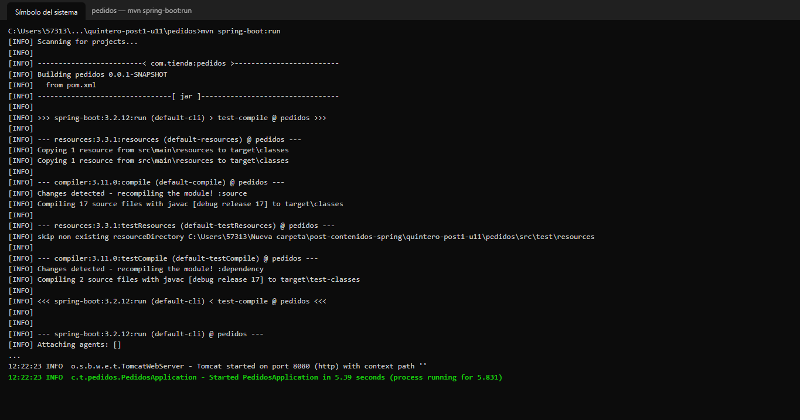
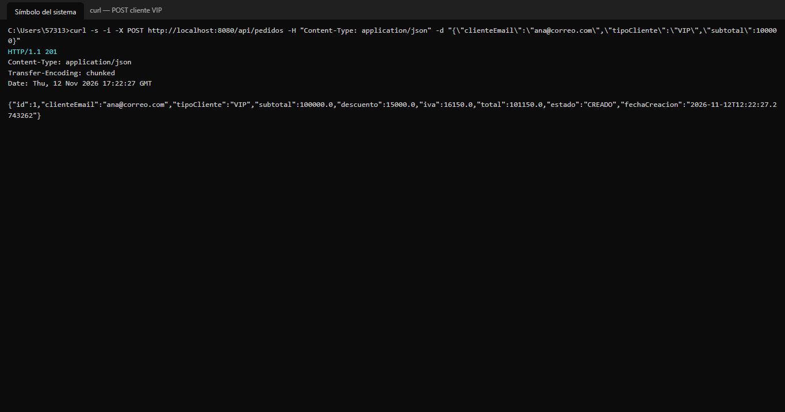
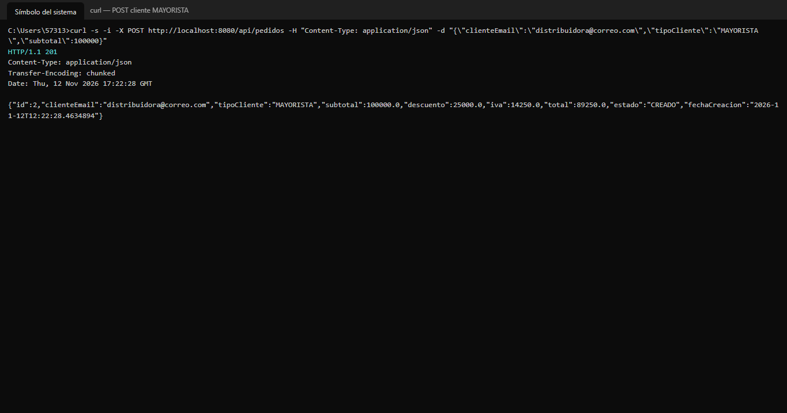
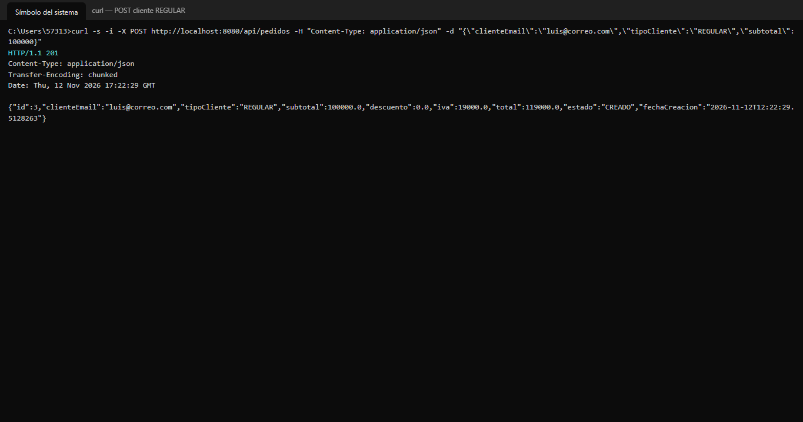
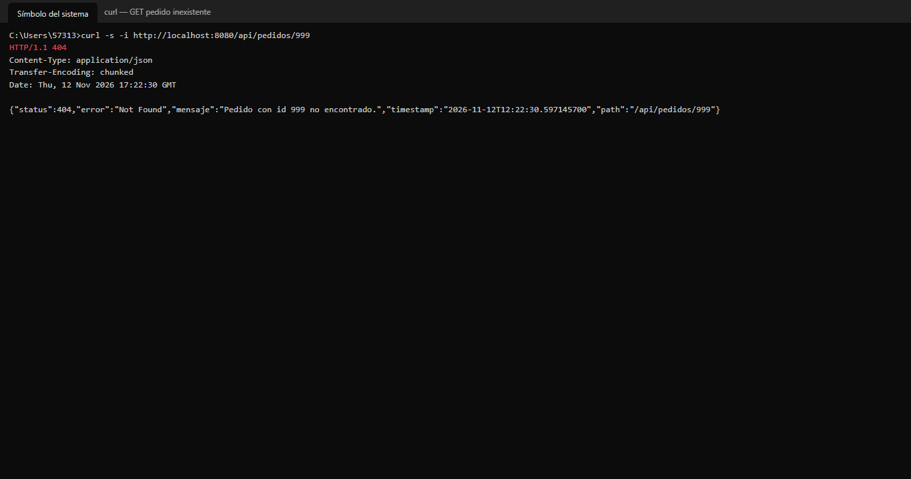
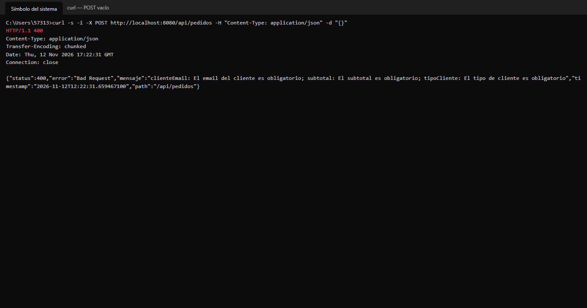
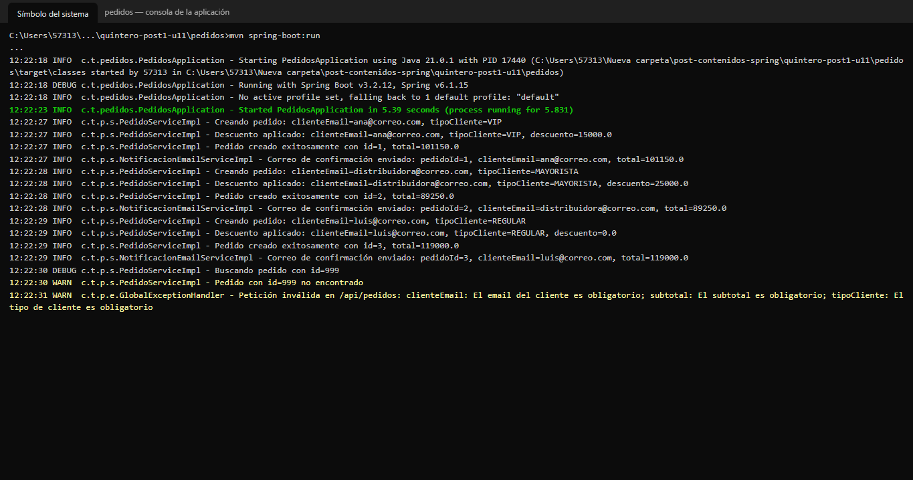
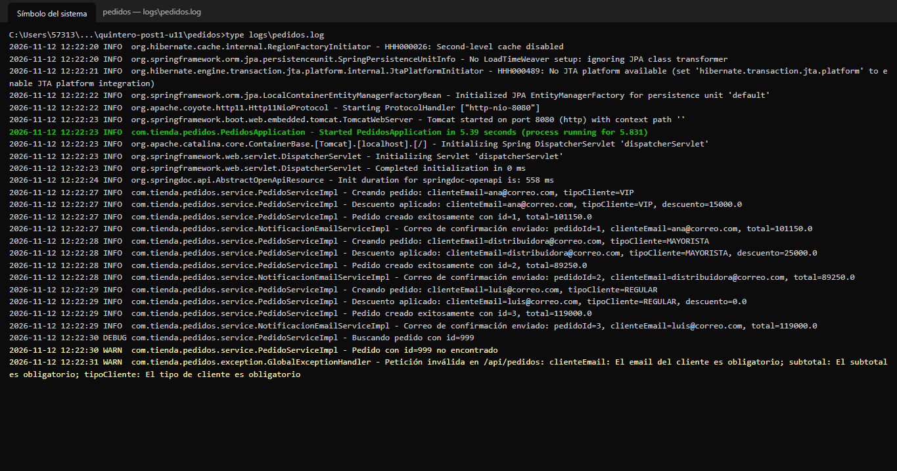
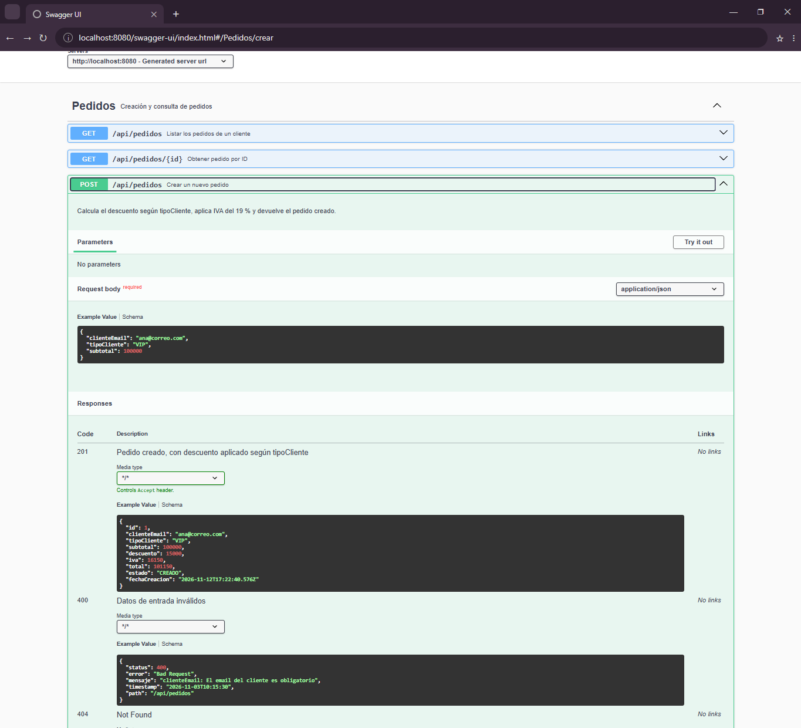

# Post-contenido — Unidad 11: Buenas Prácticas y Patrones de Diseño

## Descripción

Repositorio del laboratorio de la Unidad 11 de Programación Web — Séptimo
Semestre. Contiene un único proyecto Maven Spring Boot (`pedidos/`, paquete
`com.tienda.pedidos`) que parte de un código de gestión de pedidos con
violaciones reales de SOLID (SRP y DIP), SQL embebido y la entidad JPA
expuesta en la API (primer commit del historial), y lo refactoriza con
arquitectura en capas, el patrón DTO, inyección de dependencias por
constructor y el patrón **Strategy** para el descuento por tipo de cliente
(Parte 1). Luego se endurece con manejo centralizado de errores
(`@RestControllerAdvice`), logging con SLF4J/Logback y documentación con
springdoc-openapi/Swagger (Parte 2).

**Estudiante:** Neidys Mariana Quintero Carrillo

## Tecnologías

Spring Boot 3.2 (Web, Data JPA, Validation), H2, SLF4J + Logback,
springdoc-openapi 2.3.0 (Swagger UI), JUnit 5 + Mockito, Java 17, Maven.

## Violaciones del código de partida y cómo se corrigió cada una

| # | Violación en el código de partida | Corrección |
|---|---|---|
| 1 | **SRP**: `crearPedido` validaba, calculaba el descuento, armaba el SQL, persistía, notificaba y registraba el log (seis responsabilidades). | El controller solo traduce HTTP ↔ DTO. La validación pasa a Bean Validation en `PedidoRequestDTO`, el cálculo a las estrategias, la orquestación a `PedidoServiceImpl`, la persistencia a `PedidoRepository`, la notificación a `NotificacionService` y el log a SLF4J. |
| 2 | **DIP**: `new NotificacionEmailService()` dentro del controller. | `NotificacionService` (interfaz) + `NotificacionEmailServiceImpl` (`@Service`) inyectada por constructor. El controller depende de la interfaz `PedidoService`. No queda ningún `new` de un colaborador. |
| 3 | **Sin capa de acceso a datos**: SQL concatenado con `JdbcTemplate` en el controller (inyección SQL). | `PedidoRepository extends JpaRepository<Pedido, Long>` con la consulta derivada `findByClienteEmailOrderByIdAsc`. No queda ninguna sentencia SQL escrita a mano. |
| 4 | **Entidad expuesta**: se devolvía `Pedido` completo, incluido `notasInternas`. | `PedidoRequestDTO` (entrada, con `@NotBlank`, `@Email`, `@NotNull`, `@Positive`) y `PedidoResponseDTO` (salida, **sin** `notasInternas`), con mapeo explícito en `toResponseDTO()`. |
| 5 | **Lógica condicional rígida**: `if / else if / else` por tipo de cliente. | Strategy: `EstrategiaDescuento` + `DescuentoRegular`, `DescuentoVip`, `DescuentoMayorista`, inyectadas como `Map<String, EstrategiaDescuento>`. |
| 6 | **Errores silenciados**: `try/catch` con `println` que devolvía `null` (200 OK vacío para un id inexistente). | `RecursoNoEncontradoException` + `GlobalExceptionHandler` → `404` con `ApiError`. |
| 7 | **`System.out.println`** como log. | SLF4J con placeholders `{}` y niveles DEBUG/INFO/WARN/ERROR; `logback-spring.xml` con consola y archivo rotativo. |

## Arquitectura resultante (diagrama de clases en texto)

```
                 HTTP (JSON)
                     │
┌────────────────────▼─────────────────────┐     ┌───────────────────────────────┐
│ controller.PedidoController              │     │ exception.GlobalExceptionHandler│
│  + crear(PedidoRequestDTO): ResponseDTO  │────►│  @RestControllerAdvice          │
│  + obtener(Long): PedidoResponseDTO      │     │  404 / 400 / 500 → ApiError     │
│  + listarPorCliente(String): List<...>   │     └───────────────────────────────┘
└────────────────────┬─────────────────────┘
                     │ depende de la interfaz (DIP)
┌────────────────────▼─────────────────────┐
│ «interface» service.PedidoService        │
└────────────────────▲─────────────────────┘
                     │ implementa
┌────────────────────┴─────────────────────┐   usa   ┌─────────────────────────────────┐
│ service.PedidoServiceImpl                │────────►│ «interface» strategy.            │
│  - repo: PedidoRepository                │         │   EstrategiaDescuento            │
│  - notificador: NotificacionService      │         │  + calcularDescuento(double)     │
│  - estrategias: Map<String,Estrategia..> │         └──────▲──────────▲──────────▲────┘
│  - toResponseDTO(Pedido)                 │       DescuentoRegular  DescuentoVip  DescuentoMayorista
└───────┬───────────────────────┬──────────┘       @Component("REGULAR") ("VIP")  ("MAYORISTA")
        │                       │
┌───────▼──────────────┐  ┌─────▼──────────────────────────┐
│ «interface»          │  │ «interface» NotificacionService │
│ repository.          │  └─────▲──────────────────────────┘
│ PedidoRepository     │        │ NotificacionEmailServiceImpl
│ extends JpaRepository│
└───────┬──────────────┘
        │ persiste
┌───────▼──────────────┐   dto.PedidoRequestDTO  (entrada, Bean Validation, @Schema)
│ entity.Pedido (@Entity)│ dto.PedidoResponseDTO (salida, sin notasInternas)
└──────────────────────┘
```

Paquetes: `controller`, `service`, `repository`, `dto`, `entity`,
`strategy`, `exception`.

## Parte 1 — Refactorización con SOLID, DTO y Strategy

- **Checkpoint 1 (DTO + DAO):** DTOs de entrada/salida y `PedidoRepository`;
  el SQL embebido desaparece.
- **Checkpoint 2 (DIP):** `PedidoService`/`PedidoServiceImpl` y
  `NotificacionService` inyectados por constructor; el controller delega.
- **Checkpoint 3 (Strategy):** con `subtotal = 100000`:

| tipoCliente | descuento | iva (19 % de subtotal − descuento) | total |
|---|---|---|---|
| VIP        | 15000 | 16150 | 101150 |
| MAYORISTA  | 25000 | 14250 | 89250  |
| REGULAR    | 0     | 19000 | 119000 |

Un tipo desconocido (por ejemplo `ORO`) usa la estrategia `REGULAR` y deja un
log `WARN`. Estos valores también los verifica `PedidoServiceImplTest`.

## Parte 2 — Manejo de errores, logging y documentación

- **`GlobalExceptionHandler`** (`@RestControllerAdvice`):
  `RecursoNoEncontradoException` → 404, `MethodArgumentNotValidException`
  → 400 (todos los campos inválidos en `mensaje`),
  `HttpMessageNotReadableException` → 400 (JSON mal formado),
  `MissingServletRequestParameterException` → 400 (`GET /api/pedidos` sin
  `clienteEmail`), `MethodArgumentTypeMismatchException` → 400
  (`GET /api/pedidos/abc`),
  `Exception` → 500 con mensaje genérico (el detalle técnico va al log
  `ERROR`, nunca al cliente). No queda ningún `try/catch` en el controller.
- **SLF4J/Logback:** `INFO` en operaciones exitosas (pedido creado, descuento
  aplicado, notificación), `WARN` en situaciones inusuales (pedido no
  encontrado, tipo de cliente desconocido, petición inválida), `ERROR` en
  excepciones no previstas y `DEBUG` en consultas. `logback-spring.xml`
  define el appender `CONSOLA` y el `RollingFileAppender` `ARCHIVO`
  (`logs/pedidos.log`, rotación diaria `logs/pedidos.%d{yyyy-MM-dd}.log`,
  `maxHistory` 30). La carpeta `logs/` está en `.gitignore`.
- **springdoc-openapi:** `@OpenAPIDefinition` en `PedidosApplication`,
  `@Tag` en el controller, `@Operation` + `@ApiResponse` (201/200, 400, 404
  con esquema `ApiError`) en los **tres** endpoints y `@Schema` con
  descripción y ejemplo en `PedidoRequestDTO`, `PedidoResponseDTO` y `ApiError`.

| Método | Ruta | Respuestas |
|---|---|---|
| POST | `/api/pedidos` | 201 `PedidoResponseDTO` · 400 `ApiError` |
| GET | `/api/pedidos/{id}` | 200 `PedidoResponseDTO` · 404 `ApiError` |
| GET | `/api/pedidos?clienteEmail=` | 200 lista · 400 `ApiError` si falta el parámetro |

## Decisiones de diseño

### Parte 1

- **`JpaRepository` en vez de mantener `JdbcTemplate`:** el SQL concatenado
  exponía el proyecto a inyección SQL y obligaba a sincronizar las sentencias
  con la entidad a mano. Spring Data genera el CRUD y las consultas derivadas
  como sentencias parametrizadas, con verificación de tipos en compilación.
- **Strategy (y no un segundo patrón creacional para el DTO):** el descuento
  tiene variación real de comportamiento y puede crecer; un tipo
  `CORPORATIVO` futuro solo exige una clase nueva con
  `@Component("CORPORATIVO")`, sin modificar `PedidoServiceImpl` (OCP). La
  conversión entidad → DTO es un mapeo 1:1 sin condiciones, así que se
  resuelve con el método privado `toResponseDTO()` en lugar de una clase
  Factory/Mapper adicional (se evita sobre-ingeniería).
- **Estrategias como `Map<String, EstrategiaDescuento>` inyectado:** Spring
  llena el mapa con el nombre de cada bean como llave, así el servicio elige
  la estrategia con `get(tipo)` sin `switch` ni `if`.

### Parte 2

- **El registro del descuento aplicado vive en el servicio, no en cada
  Strategy:** un solo mensaje `INFO` inmediatamente después de invocar la
  estrategia deja un único punto de auditoría por pedido, en vez de
  dispersarlo en tres clases.
- **`notasInternas` nunca se registra ni se expone:** es información
  operativa de logística; los logs pueden compartirse con soporte y se
  conservan 30 días. Los mensajes solo incluyen identificadores
  (`id`, `clienteEmail`, `tipoCliente`) y montos.
- **El 500 no revela detalles:** el cliente recibe "Error inesperado.
  Contactar soporte." y la traza completa queda en el log `ERROR`.

## Cómo compilar y ejecutar

```bash
git clone https://github.com/neidys06/quintero-post1-u11.git
cd quintero-post1-u11/pedidos
mvn compile                # Checkpoint 1
mvn test                   # pruebas del servicio y de contexto
mvn spring-boot:run
```

```bash
# POST con cliente VIP → 201 con descuento 15000, iva 16150, total 101150
curl -i -X POST http://localhost:8080/api/pedidos -H "Content-Type: application/json" \
  -d '{"clienteEmail":"ana@correo.com","tipoCliente":"VIP","subtotal":100000}'

# GET inexistente → 404 con ApiError
curl -i http://localhost:8080/api/pedidos/999

# POST vacío → 400 con los errores de validación
curl -i -X POST http://localhost:8080/api/pedidos -H "Content-Type: application/json" -d '{}'
```

Logs: en la consola y en `pedidos/logs/pedidos.log`.
Swagger UI: http://localhost:8080/swagger-ui.html — OpenAPI JSON: http://localhost:8080/api-docs

## Capturas de pantalla

### Parte 1

**Compilación exitosa (`mvn compile` / arranque con `mvn spring-boot:run`)**


**POST cliente VIP: descuento 15000, iva 16150, total 101150, sin `notasInternas`**


**POST cliente MAYORISTA: descuento 25000**


**POST cliente REGULAR: descuento 0**


### Parte 2

**GET `/api/pedidos/999`: 404 con `ApiError`**


**POST con `{}`: 400 con los errores de validación**


**Logs en consola con formato SLF4J (INFO del pedido y del descuento)**


**Archivo `logs/pedidos.log` con fecha completa**


**Swagger UI con el grupo "Pedidos" y un endpoint expandido (201/400/404)**

